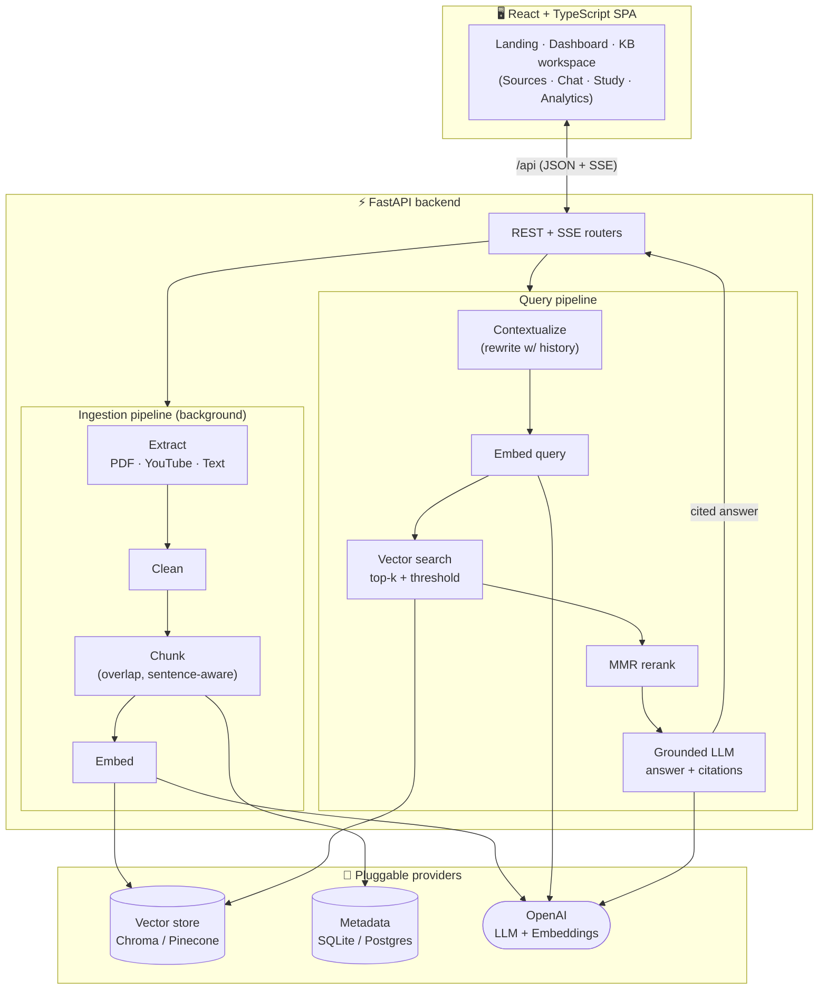

<div align="center">

# 🧠 NexusRAG

**Turn your documents, videos, and notes into an AI assistant that answers _only_ from your sources — with a citation for every claim.**

A full-stack, production-shaped Retrieval-Augmented Generation platform.


</div>

---

## Overview

NexusRAG lets you build **knowledge bases** from three kinds of sources — **PDFs, YouTube videos, and pasted text** — then chat with a grounded assistant over them. Under the hood it runs a full RAG pipeline: ingest → clean → chunk → embed → store in a vector database → retrieve with reranking → answer with a strict, source-grounded prompt.

The defining feature is **honest grounding**. Answers are constructed only from retrieved passages, every answer carries clickable citations back to the exact **PDF page** or **YouTube timestamp**, and when the sources don't contain an answer, the assistant says so instead of hallucinating.

It runs locally with **only an OpenAI API key** — the default vector store is a local, persistent ChromaDB and the default metadata store is SQLite, so there's nothing else to install or provision.

## Features

- **Multi-source ingestion** — PDFs (PyMuPDF text extraction), YouTube (transcript + metadata), and raw text, each processed by a dedicated pipeline.
- **Grounded, cited answers** — a strict system prompt plus citations computed in code from real retrieved-chunk metadata, so the model cannot invent a source.
- **Clickable citations** — jump straight to the cited PDF page (`#page=N`) or the exact YouTube moment (`&t=SECONDS`); text sources open the retrieved snippet.
- **Honest "not found"** — a similarity threshold means low-confidence retrievals return a graceful fallback instead of a made-up answer.
- **Advanced retrieval** — cosine similarity, a configurable score threshold, and **MMR reranking** for relevance + diversity (reusing already-fetched embeddings, no extra API calls).
- **Query contextualization** — follow-up questions are rewritten against chat history so "what about the second one?" retrieves correctly.
- **Streaming chat** — answers stream token-by-token over Server-Sent Events, with conversational memory per knowledge base.
- **Study mode** — generate grounded multiple-choice quizzes from a whole knowledge base or a single source, each question with an explanation and a citation.
- **Retrieval analytics** — grounded-answer rate, average relevance score, latency, and most-queried sources per knowledge base.
- **Pluggable providers** — swap ChromaDB → Pinecone, or SQLite → Postgres, via environment variables with zero code changes, thanks to clean provider abstractions.
- **Premium UI** — a dark, glassmorphic SaaS-grade interface with an animated pipeline hero, built with React + Tailwind + Framer Motion.

## Architecture



### How the RAG pipeline works

**Ingestion (runs in the background so the UI stays responsive):**

1. **Extract** — PyMuPDF pulls text per page; `youtube-transcript-api` fetches the transcript with per-segment timestamps; pasted text is taken as-is.
2. **Clean** — de-hyphenation and whitespace normalization.
3. **Chunk** — recursive, sentence-aware splitting with overlap. Crucially, each chunk keeps the metadata needed for citations: the **page number** (PDF) or **start time in seconds** (YouTube).
4. **Embed & store** — chunks are embedded (`text-embedding-3-small`) and upserted into the vector store; a row per chunk is written to the metadata DB.

**Answering a question:**

1. **Contextualize** — with ≥2 prior turns, an LLM rewrite turns a context-dependent follow-up into a standalone query.
2. **Retrieve** — embed the query, fetch the top-k nearest chunks (optionally filtered by source type), and **drop anything below the similarity threshold**.
3. **Rerank** — Maximal Marginal Relevance balances relevance against diversity so the context isn't five near-duplicate passages.
4. **Generate** — the surviving passages are formatted into a numbered context block and sent with a strict grounding prompt. **Citations are built in code** from the retrieved chunks' real metadata — the model can only reference `[n]`, never fabricate a source. If nothing survives the threshold, the assistant returns the honest not-found message.

## Tech stack

| Layer | Choices |
| --- | --- |
| **Backend** | FastAPI, Pydantic v2, SQLAlchemy 2.0, Uvicorn |
| **RAG** | OpenAI SDK (used directly — no LangChain), custom chunking + MMR reranking |
| **Vector store** | ChromaDB (default, local & persistent) · Pinecone (drop-in) |
| **Metadata store** | SQLite (default) · PostgreSQL (drop-in) |
| **Ingestion** | PyMuPDF (PDF), youtube-transcript-api (YouTube) |
| **Frontend** | React 18, TypeScript, Vite, Tailwind CSS, Framer Motion, Zustand, React Router |
| **Streaming** | Server-Sent Events (token streaming) |
| **Infra** | Docker, docker-compose, nginx (static serve + API proxy) |
| **Testing** | pytest (mock providers + in-memory vector store — runs with no API key) |

## Project structure

```
nexusrag/
├── backend/
│   ├── app/
│   │   ├── main.py                 # FastAPI app, middleware, router mounts
│   │   ├── config.py               # Pydantic settings (all env vars)
│   │   ├── db.py                   # SQLAlchemy engine/session
│   │   ├── models/                 # ORM: KnowledgeBase, Source, Chunk, ChatMessage, QueryLog
│   │   ├── schemas/                # Pydantic request/response models
│   │   ├── api/                    # Routers: knowledge_bases, sources, chat, ai_features, analytics, health
│   │   ├── services/
│   │   │   ├── ingestion_service.py    # Background ingest orchestration
│   │   │   ├── chunking_service.py     # Sentence-aware chunking w/ citation metadata
│   │   │   ├── embedding_service.py    # Embedding provider (Protocol + OpenAI impl)
│   │   │   ├── retrieval_service.py    # Vector search + threshold + MMR
│   │   │   ├── rag_service.py          # Contextualize → retrieve → grounded answer/stream
│   │   │   ├── ai_features_service.py  # Summaries + quiz generation
│   │   │   ├── analytics_service.py    # Retrieval metrics
│   │   │   ├── llm_service.py           # LLM provider (Protocol + OpenAI impl)
│   │   │   ├── pdf_service.py / youtube_service.py
│   │   │   └── vectorstore/             # base Protocol, chroma, pinecone, in-memory factory
│   │   └── utils/                  # prompts, helpers (YouTube URLs, timestamps)
│   ├── scripts/seed_demo.py        # Seeds a demo knowledge base
│   ├── tests/                      # pytest suite (mock providers, no keys needed)
│   ├── requirements.txt · Dockerfile · .env.example
│
├── frontend/
│   ├── src/
│   │   ├── pages/                  # Landing, Dashboard, KnowledgeBase
│   │   ├── layouts/AppShell.tsx    # Sidebar + responsive shell
│   │   ├── components/
│   │   │   ├── landing/            # Animated pipeline hero
│   │   │   ├── dashboard/          # KB cards + create modal
│   │   │   ├── kb/                 # Sources, Chat, Citations, Quiz, Analytics panels
│   │   │   └── ui/                 # Modal, Tabs, Toaster, Spinner, ConfirmDialog
│   │   ├── services/api.ts         # Typed API client + SSE stream parser
│   │   ├── stores/useAppStore.ts   # Zustand store
│   │   └── types/index.ts
│   ├── nginx.conf · Dockerfile · .env.example
│
├── docker-compose.yml
├── docs/INTERVIEW_NOTES.md         # Design rationale & talking points
└── README.md
```

## Getting started

### Prerequisites

- Python 3.11+
- Node.js 18+
- An OpenAI API key ([get one here](https://platform.openai.com/api-keys))

### 1. Backend

```bash
cd backend
python -m venv .venv
source .venv/bin/activate          # Windows: .venv\Scripts\activate
pip install -r requirements.txt

cp .env.example .env               # then edit .env and set OPENAI_API_KEY
uvicorn app.main:app --reload      # http://localhost:8000  (docs at /docs)
```

Optionally seed a demo knowledge base to click around immediately:

```bash
python scripts/seed_demo.py
```

### 2. Frontend

```bash
cd frontend
npm install
npm run dev                        # http://localhost:5173
```

The Vite dev server proxies `/api` to `http://localhost:8000`, so the two run side by side with no CORS fuss. Open **http://localhost:5173** and start building a knowledge base.

## Environment variables

Set these in `backend/.env` (see `.env.example` for the full list). Only `OPENAI_API_KEY` is required to get going.

| Variable | Default | Description |
| --- | --- | --- |
| `OPENAI_API_KEY` | — | **Required.** Your OpenAI key. |
| `LLM_MODEL` | `gpt-4o-mini` | Chat model for answers, contextualization, quizzes. |
| `EMBEDDING_MODEL` | `text-embedding-3-small` | Embedding model (1536 dims). |
| `VECTOR_STORE` | `chroma` | `chroma` (local) or `pinecone`. |
| `DATABASE_URL` | `sqlite:///./nexusrag.db` | Swap to a `postgresql+psycopg://…` URL for Postgres. |
| `CHUNK_SIZE` / `CHUNK_OVERLAP` | `900` / `150` | Chunking size and overlap (characters). |
| `RETRIEVAL_TOP_K` | `12` | Candidates fetched from the vector store. |
| `RERANK_TOP_N` | `5` | Passages kept after MMR reranking. |
| `SIMILARITY_THRESHOLD` | `0.18` | Minimum cosine similarity; below this → "not found". |
| `MMR_LAMBDA` | `0.6` | MMR relevance/diversity trade-off (1 = pure relevance). |
| `MAX_UPLOAD_MB` | `25` | Max PDF upload size. |
| `CORS_ORIGINS` | dev origins | Comma-separated allowed frontend origins. |
| `PINECONE_API_KEY` / `PINECONE_INDEX` | — | Only when `VECTOR_STORE=pinecone`. |

## Run with Docker

```bash
cp backend/.env.example backend/.env   # add your OPENAI_API_KEY
docker compose up --build
# open http://localhost:8080
```

`frontend` (nginx) serves the built SPA and reverse-proxies `/api` to the `backend` service, so the whole app — including SSE streaming — is same-origin. Uploads and the Chroma index persist in the `nexus_storage` volume.

## API

Interactive OpenAPI docs are served at **`http://localhost:8000/docs`**. Key endpoints:

| Method | Path | Purpose |
| --- | --- | --- |
| `POST` | `/api/knowledge-bases` | Create a knowledge base |
| `POST` | `/api/sources/pdf` \| `/youtube` \| `/text` | Add a source (ingested in the background) |
| `GET` | `/api/sources/{id}` | Poll ingestion status |
| `GET` | `/api/sources/{id}/file` | Serve a PDF (for citation deep-links) |
| `POST` | `/api/chat` | Ask a question (JSON or SSE stream) |
| `POST` | `/api/quiz` · `/api/summarize` | Study-mode features |
| `GET` | `/api/analytics/{kb_id}` | Retrieval metrics |

## Example queries

Create a knowledge base, drop in a lecture PDF or a technical YouTube video, wait for indexing, then try:

- *"Summarize the key ideas across these sources."*
- *"What does the paper say about overfitting, and where?"* → answer cites the exact page.
- *"At what point in the video is backpropagation explained?"* → citation links to the timestamp.
- Ask something the sources don't cover → the assistant tells you it couldn't find it, rather than guessing.

## Testing

The backend suite runs with **no API key and no external services** — it injects deterministic mock LLM/embedding providers and an in-memory vector store through the same dependency-injection hooks the app uses in production.

```bash
cd backend
pip install -r requirements-dev.txt
pytest
```

Coverage spans helpers (YouTube URL parsing, timestamps), chunking (size/overlap/metadata), and the API (KB CRUD, ingestion, grounded chat, SSE streaming, quiz, analytics).

## Deployment

- **Frontend** → any static host (Vercel / Netlify). Build with `npm run build`; set `VITE_API_URL` to your backend's public `/api` URL if it's on a different origin.
- **Backend** → any container host (Render / Fly.io / Railway). Point `DATABASE_URL` at managed Postgres and set `VECTOR_STORE=pinecone` with your Pinecone credentials for a fully managed, stateless deployment.
- **Or** ship the whole thing with the included `docker-compose.yml`.

## Roadmap / future improvements

These are deliberate extension points, documented in `docs/INTERVIEW_NOTES.md`:

- Full user authentication & multi-tenant knowledge bases
- In-app PDF.js viewer with highlighted citation spans (currently deep-links to the page)
- Hybrid retrieval (BM25 + dense) and a cross-encoder reranker
- Celery/Redis for durable, distributed ingestion at scale
- Evaluation harness (faithfulness / answer-relevance scoring)

## License

MIT © 2026 Suraj Padala — see [LICENSE](./LICENSE).
